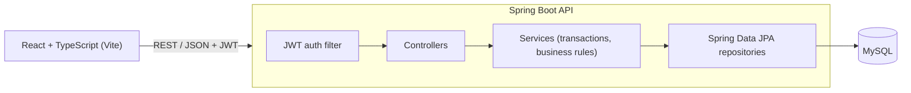

# Online Course Registration System


A full stack web app where students browse a course catalog, enroll in courses and drop them, while admins manage courses and see who is enrolled. It is built with **Java 17, Spring Boot 3, Spring Security (JWT), Spring Data JPA, MySQL and React with TypeScript**, and runs with one `docker compose up`.

The interesting part is seat handling: when many students try to grab the last seats in a course at the same moment, the course never ends up over capacity. The integration tests prove it with 10 concurrent enrollment requests for 3 seats.

## Features

**Students**
- Register and sign in (JWT, passwords hashed with BCrypt)
- Search the catalog by title, code or instructor, with pagination
- See live seat availability (open / almost full / full)
- Enroll and drop courses, with a per-term credit limit (18 credits)

**Admins**
- Create, edit and delete courses (validation on every field)
- View the roster of students enrolled in each course
- Capacity can't be lowered below the number of students already enrolled

**Engineering**
- Stateless REST API secured with Spring Security and JWT, with role-based access (`STUDENT`, `ADMIN`)
- Pessimistic row locking on the course during enroll and drop, so the seat check and seat update can't race
- Consistent error responses using RFC 7807 problem details, including per-field validation errors
- OpenAPI docs with Swagger UI
- Unit tests (JUnit 5, Mockito) and integration tests (Spring Boot Test, MockMvc, H2), plus Vitest for the UI
- Docker images for backend and frontend, docker-compose with MySQL, GitHub Actions CI

## Architecture



The backend follows a layered structure:

```
backend/src/main/java/com/saicharan/courseregistration
├── config        Security config, demo data seeder
├── domain        JPA entities: User, Course, Enrollment
├── dto           Request/response records with Bean Validation
├── exception     Custom exceptions and the global exception handler
├── repository    Spring Data JPA repositories (incl. locking query)
├── security      JWT service, auth filter, UserDetailsService
├── service       AuthService, CourseService, EnrollmentService
└── web           REST controllers
```

## Tech stack

| Layer | Technologies |
|---|---|
| Backend | Java 17, Spring Boot 3.3, Spring MVC, Spring Security, Spring Data JPA, Hibernate, Bean Validation, jjwt |
| Database | MySQL 8 (H2 in-memory for local dev and tests) |
| Frontend | React 18, TypeScript, React Router, Axios, Vite |
| Testing | JUnit 5, Mockito, Spring Boot Test, MockMvc, Vitest |
| DevOps | Docker, docker-compose, Nginx, GitHub Actions, Maven |
| Docs | springdoc-openapi (Swagger UI) |

## Run it

### Option 1: Docker (everything, with MySQL)

```bash
docker compose up --build
```

- App: http://localhost:3000
- API docs: http://localhost:8080/swagger-ui.html

### Option 2: Local development

Backend (uses an in-memory H2 database, no setup needed):

```bash
cd backend
mvn spring-boot:run
```

Frontend (proxies `/api` to the backend on port 8080):

```bash
cd frontend
npm install
npm run dev
```

Open http://localhost:5173.

### Demo accounts

Created automatically on an empty database:

| Role | Email | Password |
|---|---|---|
| Admin | admin@demo.edu | Admin@1234 |
| Student | student@demo.edu | Student@1234 |

## API overview

| Method | Endpoint | Access | Description |
|---|---|---|---|
| POST | `/api/auth/register` | Public | Create a student account, returns a JWT |
| POST | `/api/auth/login` | Public | Sign in, returns a JWT |
| GET | `/api/courses?q=&page=&size=` | Public | Search courses (paginated) |
| GET | `/api/courses/{id}` | Public | Course details |
| POST | `/api/enrollments` | Student | Enroll in a course `{ "courseId": 1 }` |
| GET | `/api/enrollments/me` | Student | My active enrollments |
| DELETE | `/api/enrollments/{id}` | Student | Drop a course |
| POST | `/api/admin/courses` | Admin | Create a course |
| PUT | `/api/admin/courses/{id}` | Admin | Update a course |
| DELETE | `/api/admin/courses/{id}` | Admin | Delete a course with no active enrollments |
| GET | `/api/admin/courses/{id}/enrollments` | Admin | Course roster |

Errors come back as problem details, for example:

```json
{
  "status": 409,
  "title": "Conflict",
  "detail": "CS-575 is full"
}
```

## Design notes

**Why pessimistic locking for seats?** Enrollment is a read-check-write: read the seats taken, check there is room, then add one. Two requests doing that at the same time can both see one seat left. `CourseRepository.findByIdForUpdate` takes a `PESSIMISTIC_WRITE` lock (`SELECT ... FOR UPDATE`) inside the enrollment transaction, so the second request waits until the first commits and then sees the course is full. Optimistic locking with `@Version` would also work but needs retry logic, and seat contention spikes when registration opens, so locking is simpler and predictable here.

**Why JWT?** The API is stateless, so it scales horizontally without sticky sessions, and the React app just sends the token in the `Authorization` header.

## Tests

```bash
cd backend && mvn verify      # unit + integration tests
cd frontend && npm test       # UI unit tests
```

`RegistrationFlowTest` covers the full flow (register, search, enroll, duplicate enroll, drop), the security rules (401 without a token, 403 for students on admin endpoints, wrong password), validation errors, and the concurrent last-seat scenario.

## Roadmap

- Waitlist that auto-enrolls the next student when a seat frees up
- Email notifications on enroll and drop (Kafka event + consumer)
- Prerequisite checks between courses
- Deploy to AWS (ECS + RDS)

## Author

**Sai Charan V** · Full Stack Java Developer · [LinkedIn](https://www.linkedin.com/in/scharanv/)
